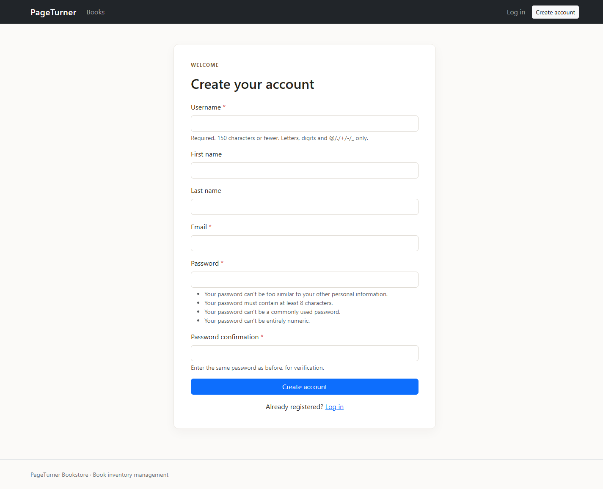
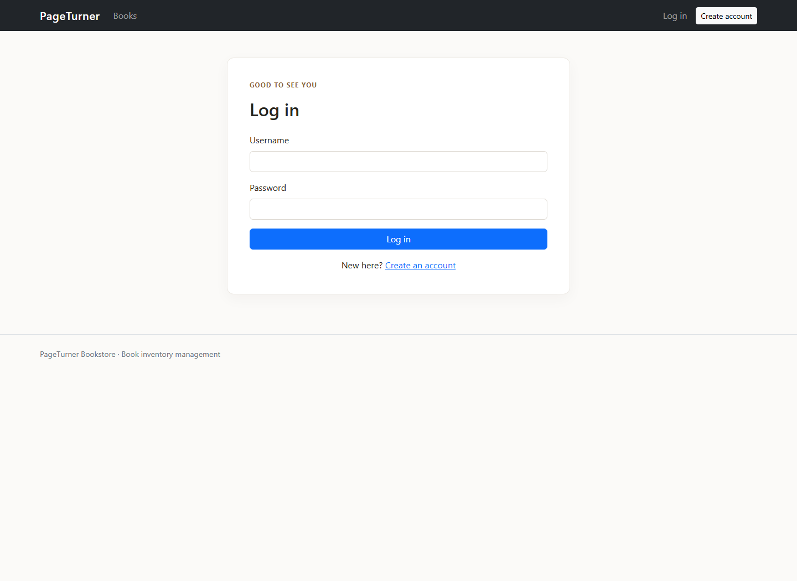
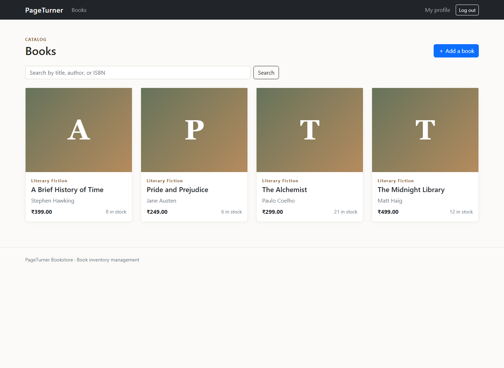
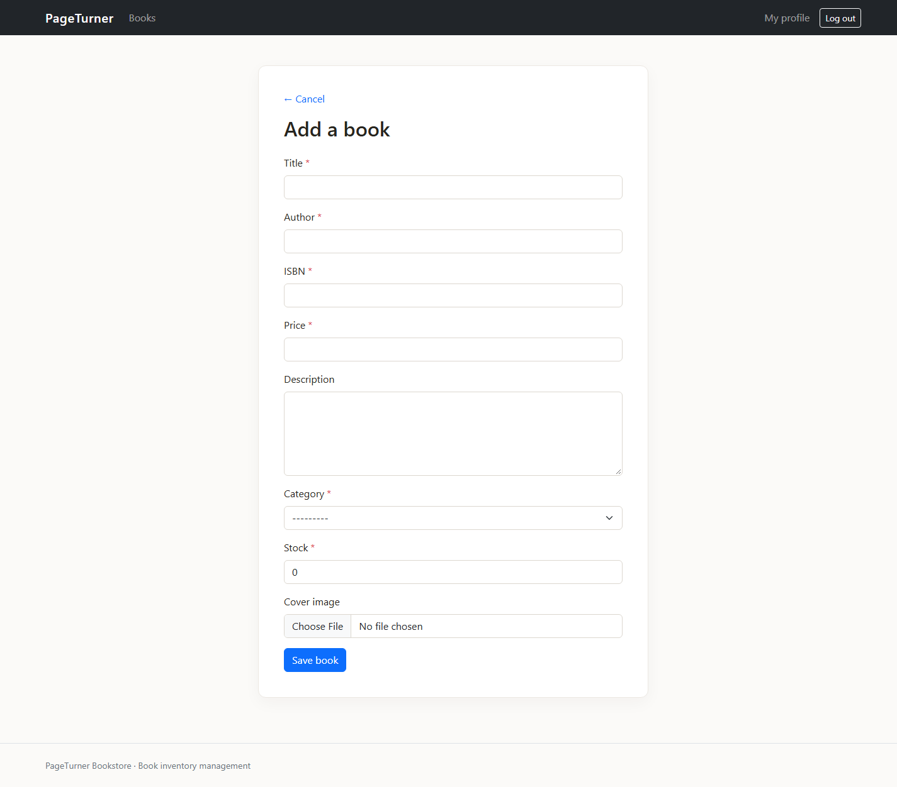
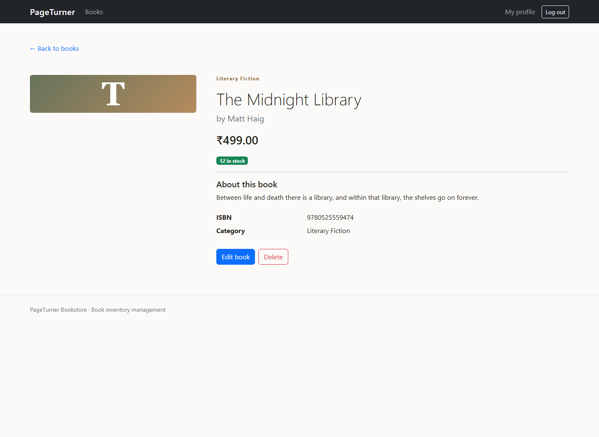
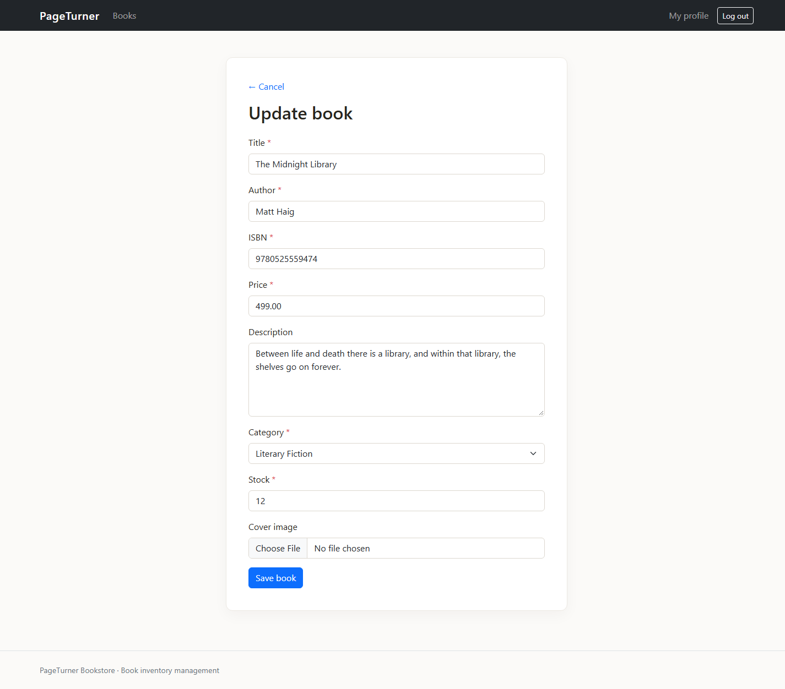

# Day 1 submission: PageTurner Bookstore

The project root contains the current Django implementation and migrations. These screenshots capture the Day 1 authentication and book management features using a local SQLite demo catalog.

## Evidence

### Registration

### Login

### Book catalog and management actions

### Add a book

### Book details with edit and delete actions

### Edit book

## Included in the project

- Registration, login, logout, and profile editing.
- Book list/search, details, add, edit, and delete flows.
- Account profile, category, and book models with migrations.
- MySQL configuration via `.env`; SQLite is available for local demonstrations.
- Bootstrap templates and book cover uploads.

The screenshot catalog uses local demo records. They are not production data. Start the app using the setup steps in the root `README.md`.
