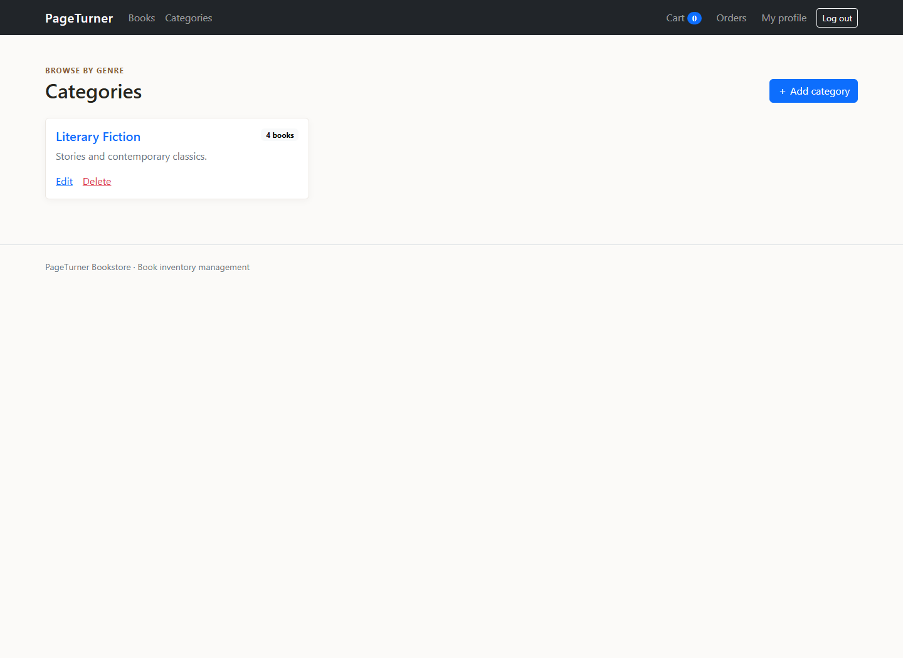
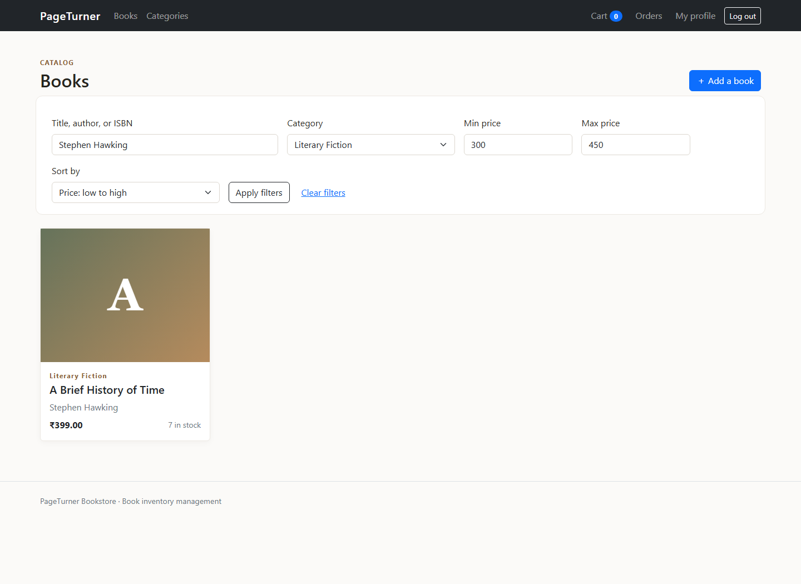
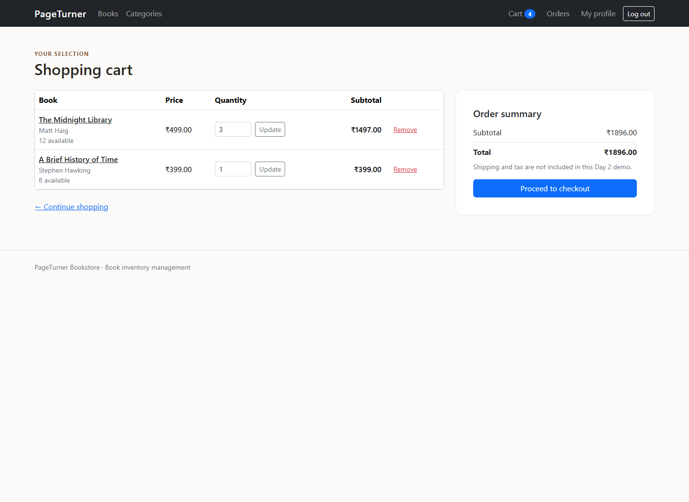
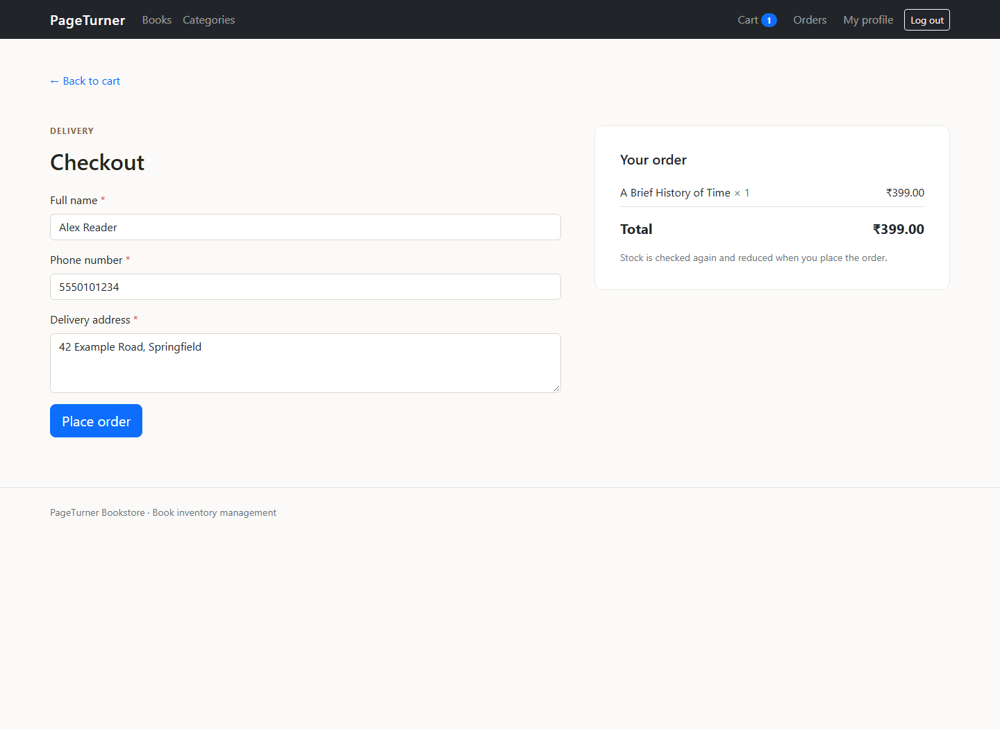
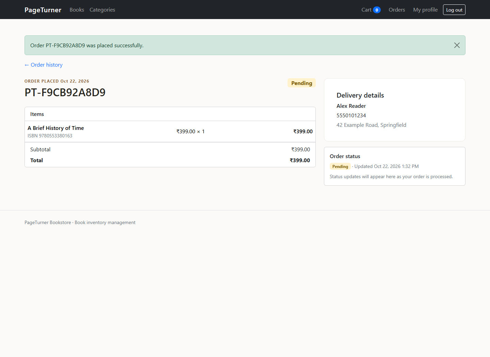
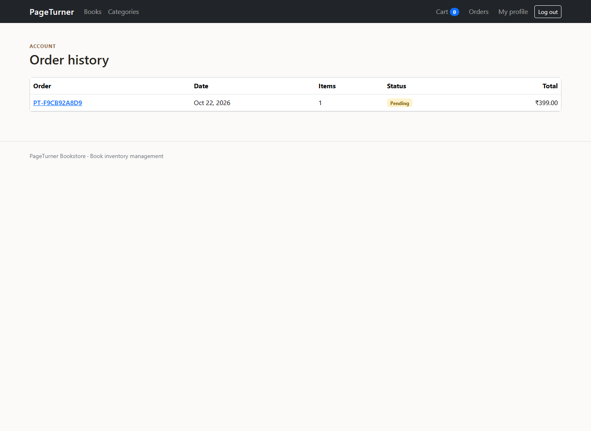

# Day 2 submission: Categories, Search, Cart, and Orders

This folder contains screenshots captured from the running Django app. The complete source and migrations are included in the project root and in `deliverables/day2/day2-submission.zip`.

## Screenshots

### Category management

### Search, category and price filters, and sorting

### Cart with multiple items and an updated quantity

### Cart after removing an item

### Checkout

### Successful order and order history

The local demo placed order `PT-F9CB92A8D9` for one copy of *A Brief History of Time*. Its stock decreased from 8 to 7, and the cart was cleared after checkout. The demo SQLite data is local and is not included in the project archive.
