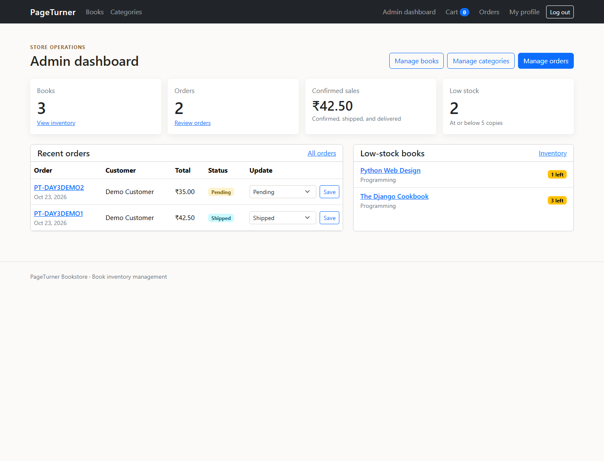
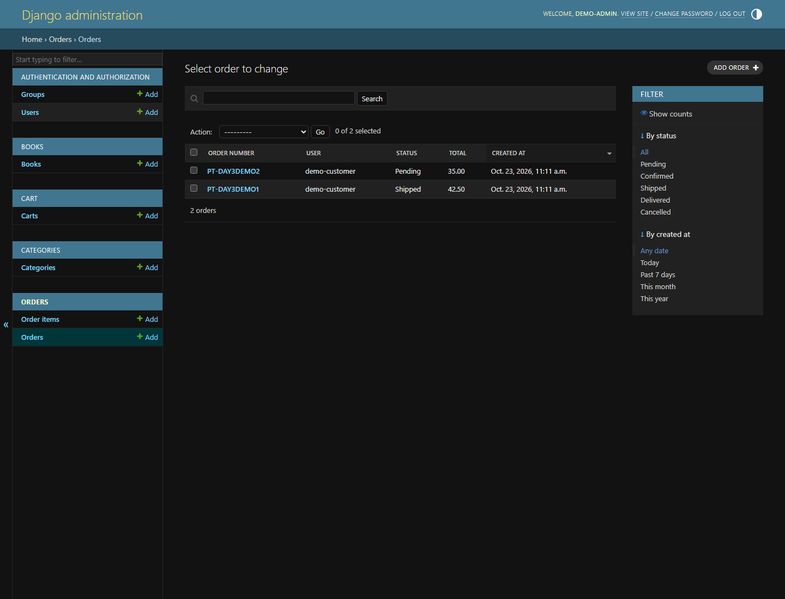

# Day 3 submission: Admin dashboard, integration, and testing

Day 3 adds staff-only store operations, order lifecycle management, and integration tests to the existing Django bookstore. The dashboard is available at `/dashboard/`; the Django administration site is available at `/admin/`.

## Dashboard and management

- Summary cards show the book count, order count, confirmed sales, and low-stock count.
- Low-stock books are listed at the configurable-in-code threshold of five copies or fewer.
- Staff can update orders from the dashboard or Django admin and manage books and categories from the linked admin lists.
- Supported order statuses are Pending, Confirmed, Shipped, Delivered, and Cancelled.
- Cancelling an order restores its reserved stock once. Reopening a cancelled order reserves stock again and is rejected when stock is insufficient or a book was deleted.
- Book and category write pages, order management, and the dashboard require a staff account.

## Screenshots

The screenshots use synthetic local demo data and are captured from the running Django application.

### Staff dashboard



### Order administration



## Setup and demonstration

Follow the SQLite setup in the root [README](../../../README.md), create a superuser, and add categories and books. Register a customer account and complete checkout. Sign in as a staff user and open `/dashboard/` to review the inventory, update order statuses, and use Django admin for catalog and order records.

Run the automated test suite and checks from the repository root:

```powershell
$env:DB_ENGINE = "sqlite3"
python manage.py test
python manage.py check
python manage.py makemigrations --check --dry-run
```

See [test cases and results](TEST_RESULTS.md) for the tested scenarios.
